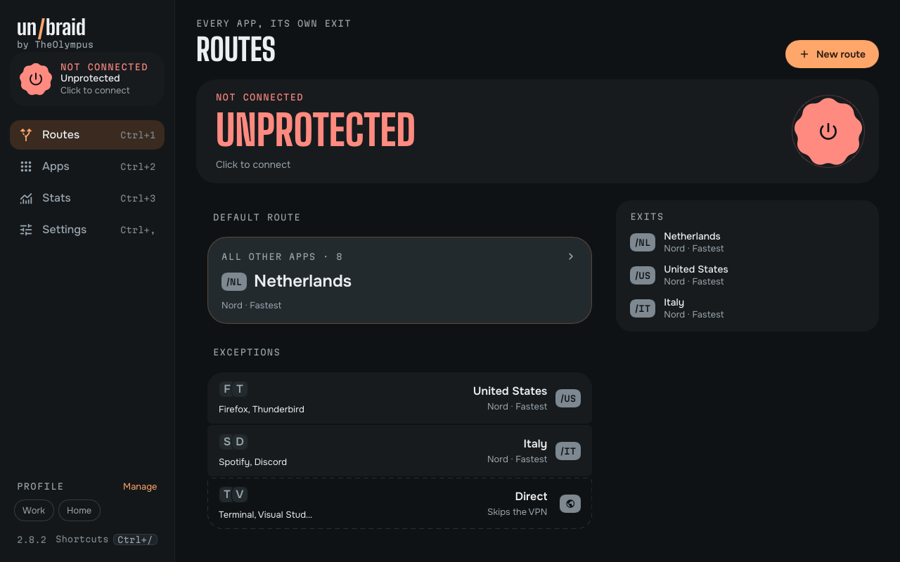
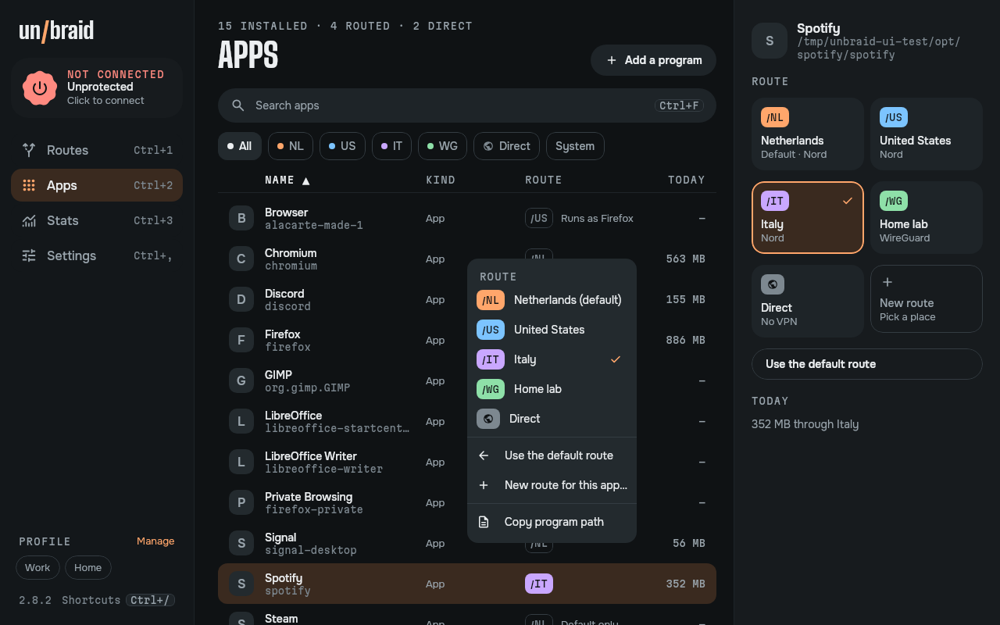
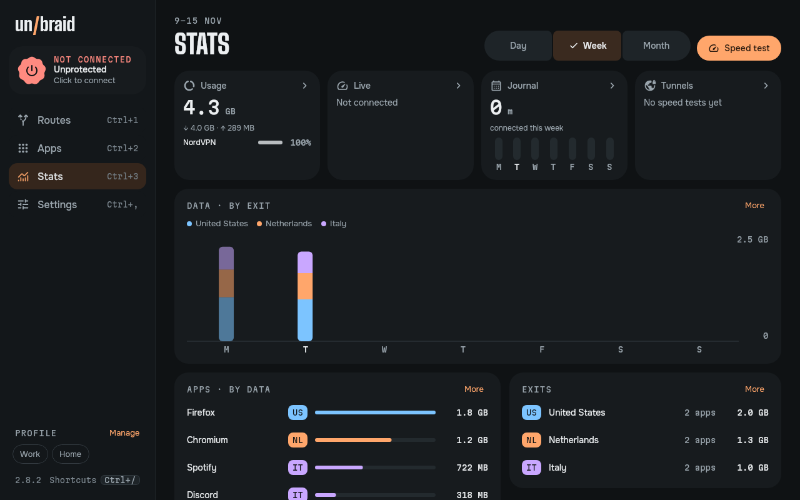
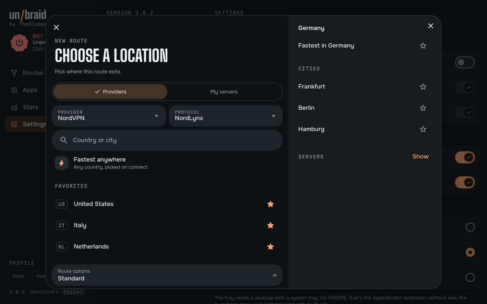
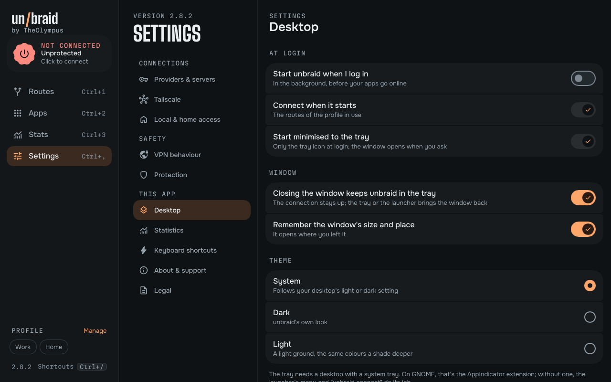
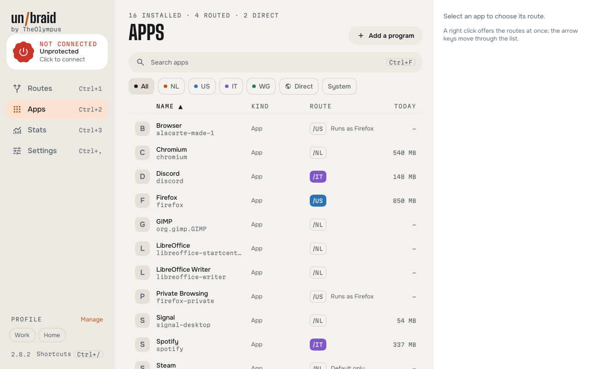
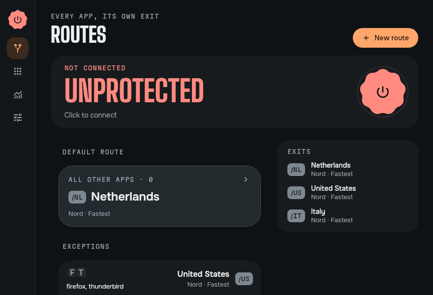

# unbraid for Linux

unbraid is a split tunneling VPN client that lets every app take its own exit. Your banking app can skip the VPN while
a streaming app leaves from the US, a second app from Italy and everything else from the Netherlands, all at the same
time. If you use Tailscale, your home network stays reachable too.

This is the Linux version of [unbraid for Android](https://github.com/Quiet-Crafts/unbraid) 2.8.2, made by Quiet
Crafts: the same features, the same look laid out for a computer, and the same code where Linux allows it. It runs on
Debian 13 and later, Ubuntu 24.04 and later, Arch Linux, and the distributions built on them, on x86-64.



## What it works with

You bring the VPN. unbraid has no servers of its own and works with the accounts and servers you already have.

You can sign in with NordVPN (NordLynx, OpenVPN, Double VPN and Onion over VPN), Mullvad, Private Internet Access,
IVPN or ExpressVPN. For Proton VPN (Free included) and Surfshark you add your WireGuard key once, and for Windscribe and
AirVPN you paste one WireGuard config from their website. After that you choose from the servers your plan includes.
You can also import your own WireGuard or OpenVPN config, paste a Shadowsocks key, or join a Tailscale tailnet (a
self-hosted Headscale works as well).

Routes can mix providers. One app can use Mullvad in Sweden while another uses NordVPN in Japan.

## How it works on Linux

```
apps -> TUN -> unbraid-engine -> rules: DNS, home, LAN, the app's route, default
                                 |- one WireGuard, OpenVPN or Shadowsocks exit per location
                                 |- Tailscale node (home)
                                 '- direct
```

unbraid comes in two parts:

- **The app** (`unbraid`) is the window you use: routes, apps, profiles, statistics and settings. It keeps your setup,
  talks to the providers and decides what runs. Closing the window keeps a connection running, as leaving the Android
  app keeps its VPN; the tray (where your desktop has one), the launcher or `unbraid` brings it back.
- **The engine** (`unbraid-engine.service`) is a system service: sing-box's own Linux daemon, built with the same
  patches as the Android engine. It needs root for the TUN interface and routes, and nothing else. The app reaches it
  over a local socket; the engine knows which user connects, and asks polkit before anyone first takes charge of it
  (a user at the computer is let through without a question; system accounts never are) and before one user takes over
  another's connection. It runs in a systemd sandbox: only the capabilities networking needs, the system read-only, no
  home folders.

Each TCP and UDP connection is routed by the program that owns it, which the engine looks up for every connection. An app
is a desktop entry (what your launcher lists), resolved to the programs it starts: the program itself, the folder it is
installed in (so its helpers follow it), Flatpak apps by their program's name and Snaps by their folder. A wrapper in
front of the program (`env`, `prime-run`, `gamemoderun`, `firejail`) is looked through. A program without a desktop
entry, such as a command-line tool, can be added by its file.

The engine knows a process by its program file. A script's is the interpreter that runs it (Python, Java, a shell), a
Windows program's is Wine, and an Electron app on Arch may share its Electron with others: every program they run shares
it. An AppImage runs its programs from a new folder each time. Such apps can't be told apart, so unbraid shows them
following the default route rather than offering them one of their own. Apps that run as one program, such as
LibreOffice's Writer and Calc, or a browser and its web apps, are one app to the engine and share one route: once you
give one of them a route, the others take it too.
Some apps leave part of their networking to a desktop service (KDE's file workers, GNOME's calendar and online
accounts); that part follows the default route.

DNS is answered with fake addresses and looked up again on the exit the app really uses, so a site sees the country you
picked for that app. Linux can't leave single apps out of a tunnel, so Direct apps, like your local network, pass
through the engine and leave directly. Nothing goes around the engine while it runs, and the lookups your router would
have seen go through it too. Only the default route and the routes your apps use are connected.

For NordVPN, unbraid picks a server from the provider's low-load recommendations when it connects, unless you pinned
one. Server lists come from each provider's public API where there is one, and otherwise from
[gluetun-servers](https://github.com/qdm12/gluetun-servers).

## Install

Download the package for your distribution from the releases page, or build it (below).

Debian, Ubuntu, Linux Mint and their derivatives:

```bash
sudo apt install ./unbraid_2.8.2-1_amd64.deb
```

The engine service is enabled and started for you.

Arch Linux, EndeavourOS, Manjaro and their derivatives: `packaging/build.sh` writes a `PKGBUILD` and the tree it
packages to `dist/arch/`.

```bash
cd dist/arch && makepkg -si
sudo systemctl enable --now unbraid-engine
```

Turn off any other VPN that routes all traffic, including your provider's own app.

Upgrading the package restarts the engine, which ends the connection (it never keeps your configuration to bring it
back by itself): apps use your normal connection until you connect again.

## Use

Open unbraid from your launcher. The first start plays a 16-second introduction, which a click or Esc skips. It plays
through your desktop's GStreamer; without it, the window simply opens. Then the first start walks you through the terms
and signing in. After that, give apps their exits on the Apps page, and connect on Routes.

The window is laid out for a computer. The sidebar keeps the connection and its power button in view, with the pages:
Routes, Apps, Stats and Settings; in a narrow window it folds to icons. Apps is a table to search and sort, with the
selected app's route choices in a panel beside it, and a right click on an app or a route offers its choices at once.
Choosing a location opens a dialog: the countries on the left, a country's cities and servers on the right.

| | |
|---|---|
|  |  |
|  |  |
|  |  |

Ctrl+/ lists every keyboard shortcut. The main ones:

| Keys | Does |
|---|---|
| Ctrl+1, Ctrl+2, Ctrl+3, Ctrl+, | Routes, Apps, Stats, Settings |
| Ctrl+F | Search apps |
| Ctrl+N | New route |
| Ctrl+Shift+C | Connect or disconnect |
| Ctrl+Shift+P | Pause 15 minutes |
| Esc | Close the open page or dialog |
| Ctrl+W, Ctrl+Q | Close the window, quit |

Settings, Desktop holds what a desktop app needs:
- start unbraid when you log in, connecting or not, with the window or with only the tray icon;
- keep it in the tray when the window closes (off, closing quits and ends the connection);
- remember the window's size and place;
- the theme: System follows your desktop's light or dark setting, or choose Dark or Light.

The tray icon sits in your panel's tray, on desktops that show status icons (KDE Plasma, Xfce, Cinnamon, MATE, LXQt and
others). It shows whether you're connected, paused or not connected, and its menu connects, disconnects, pauses for 5,
15 or 30 minutes or an hour (the time left shows while paused, and it resumes by itself), switches profiles and opens
the dashboard. GNOME has no tray of its own: the AppIndicator extension adds one (Ubuntu has it on by default), and the
icon appears once it is on. Without a tray, the launcher's menu and the command line below do its job, and closing the
window quits unbraid unless a connection is running: then the connection stays up, and the launcher brings the window
back.

The launcher's menu for unbraid can connect, pause and disconnect. The same works from a terminal:

```bash
unbraid connect             # connect (starts unbraid in the background if needed)
unbraid pause 15            # pause for 15 minutes; it reconnects by itself
unbraid status
unbraid disconnect
unbraid profile Work        # open Routes on a saved profile; Use there switches to it
unbraid quit
```

Starting and connecting at login (Settings, Desktop) is the Linux counterpart of Android's Always-on.
Before you log in, while paused and if unbraid stops, apps use your normal connection.

## Build

You need Rust 1.99 or later and Go 1.26 (Go fetches the exact toolchain itself through `GOTOOLCHAIN`). The packages
need `dpkg-deb`, `fakeroot`, Python 3, and `cargo install --locked cargo-audit@0.23.0 cargo-auditable@0.7.7`: their build
stops on a crate with an advisory not reviewed in `app/.cargo/audit.toml`, and the app's binary carries its crate list.

```bash
engine/build.sh                                   # builds engine/out/unbraid-engine from sing-box v1.14.4 with the patches in engine/patches/
cargo run --release --manifest-path app/Cargo.toml   # runs the app from source (with a running engine; see below)
packaging/build.sh                                # writes the .deb and the Arch PKGBUILD to dist/
```

`engine/build.sh` keeps its work files in `~/.cache/unbraid-engine`; set `WORK` to use another folder. The patches stop
the engine from writing the running configuration, which holds private keys, to disk, refuse files sent through
Taildrop, give an OpenVPN tunnel a resolver inside it when its server pushes none, let the app's connection checks look
up their servers through the tunnel being checked, and name the daemon `unbraid-engine`. To try the app without
installing it, run the engine and point the app at it:

```bash
sudo engine/out/unbraid-engine run --working-directory /var/lib/unbraid-engine --socket /run/unbraid-engine/engine.sock
UNBRAID_ENGINE_BIN=$PWD/engine/out/unbraid-engine cargo run --release --manifest-path app/Cargo.toml
```

## Test

```bash
(cd app && cargo test)        # the unit tests, every screen and the window's flows drawn headless, and the real engine
                              #   (once engine/build.sh built it) checking every compiled config and routing three
                              #   programs through their own exits
engine/build.sh test          # the engine's patch tests
DISPLAY=:99 packaging/test.sh   # installs, runs and removes the packages in clean Debian 13, Ubuntu 24.04 and Arch,
                                #   checks that Debian 12 refuses the package, and keeps the built Arch package in dist/
```

`cargo test` saves a screenshot of each screen it visits in `app/target/screenshots`, in a 1280 x 800 window, the
light theme and the smallest window too; the ones in `docs/screenshots` come from there. It needs no display; the
tray's test runs on a private session bus when `dbus-run-session` is installed. `packaging/test.sh` needs bubblewrap
and an X display (an `Xvfb :99` is fine), and no root.

## Differences from the Android app

- The window is laid out for a computer: a sidebar, a table of apps, panels beside lists, right-click menus, keyboard
  shortcuts, a tray icon and a light theme.
- Apps are desktop entries and programs, matched by the program that runs (see above), not Android packages. Scripts,
  AppImages and apps on a shared runtime (Wine, Java, Mono, .NET, a shared Electron) follow the default route, and apps
  that run as one program share its route.
- Direct apps pass through the engine and leave directly; Android leaves them out of the VPN.
- There are no quick-settings tiles or home-screen widget: the launcher's actions, the tray and the command line do
  their jobs.
- Android's Always-on and "Block connections without VPN" have no Linux counterpart. unbraid can start at login.
- QR codes are read from a picture or screenshot (there is no camera app to take one).
- Some apps' DNS lookups other than addresses (HTTPS, SVCB, TXT records) go through systemd-resolved, so they follow the
  default route rather than the app's.
- The optional Google Play tip jar is not part of this version.

## Privacy

We add no advertising or analytics of our own, and there is no unbraid account. Your setup and provider logins stay in
`~/.local/share/unbraid`, which only you can open, sealed with a key kept in your desktop keyring (or, without one, in a
file only you can read), and are only sent to the service they belong to. The engine never writes the running
configuration to disk. A Tailscale node's keys stay in the engine's own folder, which only root can read, as with
Tailscale's own Linux daemon. The list of installed apps is read on your computer so you can assign routes, and it never
leaves it. The privacy policy, with every service the app talks to, is at [unbraid.app/privacy](https://unbraid.app/privacy).

Routing by program is not a security boundary. A program you run can give itself another program's name, or put
itself in a folder an app runs from, and so take that app's route, Direct included. Android tells apps apart by their
user ID, which they can't change.

On a computer with several users, the connection belongs to the user who started it. While it runs, every user's
programs follow that user's routes, and that user's statistics list their connections too. Another user takes it over
with an administrator's password.

To report a security problem, see [SECURITY.md](SECURITY.md).

## Credits

unbraid was created by [Quiet Crafts](https://unbraid.app). This Linux version is based on their
[Android app](https://github.com/Quiet-Crafts/unbraid): its design, its features and most of its code are theirs. If you
find it useful, you can support its creator at [unbraid.app/donate](https://unbraid.app/donate/).

It is a modified version of [unbraid](https://github.com/Quiet-Crafts/unbraid) 2.8.2, changed in November 2026 to run
on Linux, and keeps the original's licence and its notice below: the GNU General Public License, version 3 or later.

## Licence

unbraid is free software under the GNU General Public License, version 3 or (at your option) any later version. See
[LICENSE](LICENSE). sing-box, which the engine is built on, is under the GPL as well.

unbraid includes or downloads work by other people under their own licences. [THIRD-PARTY.md](THIRD-PARTY.md) lists
them, and the full texts ship inside the app (Settings, Licences; generated by `engine/notices.sh` from the Go modules
that are actually linked).

unbraid is an independent project and isn't affiliated with or endorsed by the VPN providers named here, Tailscale or
SagerNet. Product names belong to their owners.
